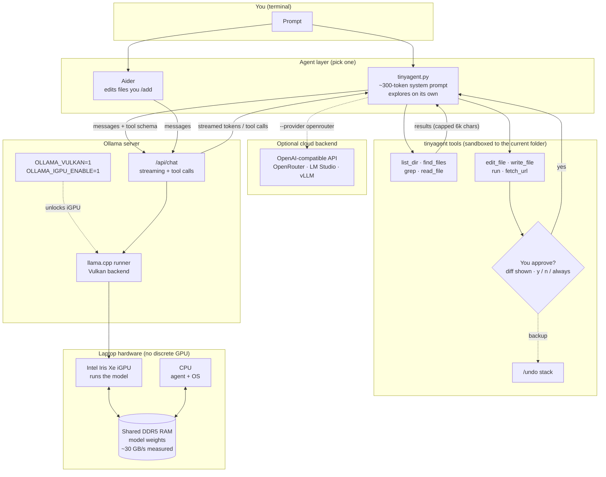
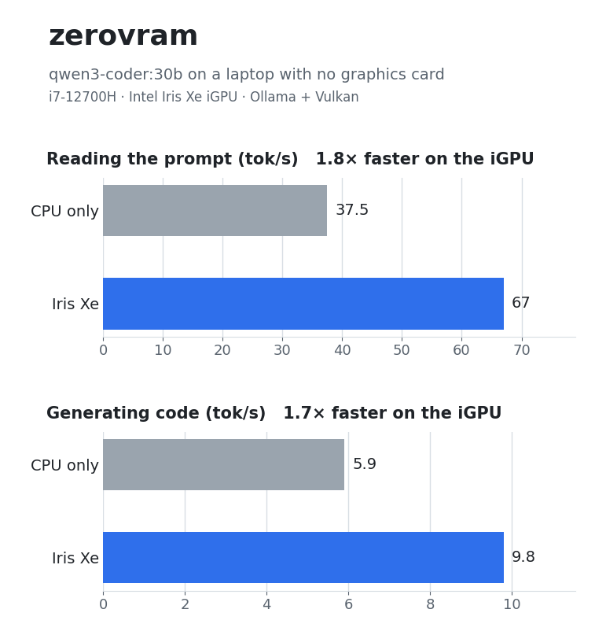
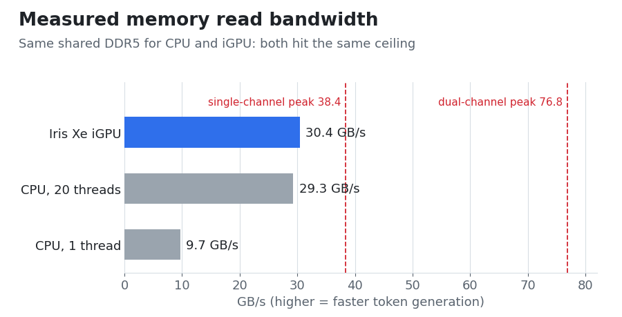
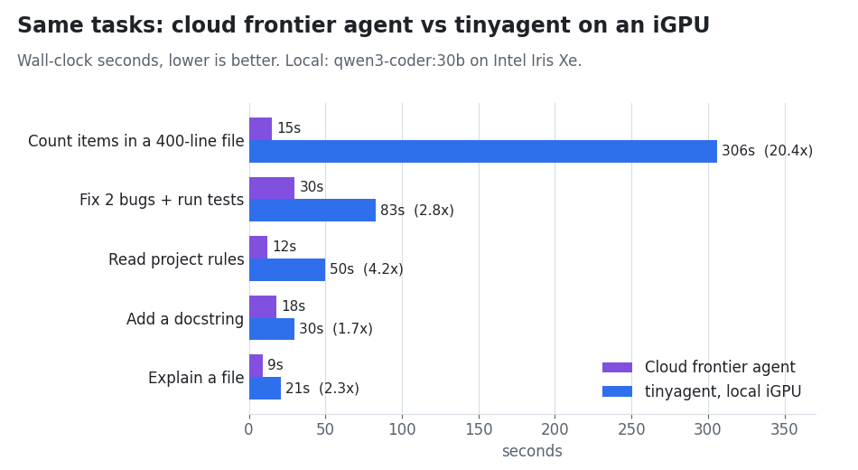

# zerovram

Run a private, offline coding agent on a laptop with **no graphics card**, just the Intel Iris Xe / Arc
integrated GPU.

## The one-line finding

Ollama detects Intel integrated GPUs and then **ignores them on purpose**. The server log says:

```
dropping integrated GPU; to enable, set OLLAMA_IGPU_ENABLE=1
```

Set two environment variables and the same model runs on the iGPU instead of the CPU:

```
OLLAMA_VULKAN=1
OLLAMA_IGPU_ENABLE=1
```

## Architecture



**Flow:** you ask a question. The agent sends it to Ollama with a small tool list. The model runs on the iGPU and
either answers or asks for a tool. Read tools run immediately. Write and run tools wait for your `y`. The agent
loops until the model answers. The speed limit is the shared RAM: the iGPU and CPU read the same ~30 GB/s.

## Results

Test machine: i7-12700H, Iris Xe (96 EU), 40 GB DDR5-4800, no discrete GPU, Windows 11, Ollama 0.40.

Prompt: 3,480 tokens. Output: up to 128 tokens.



| Model | Device | Prompt reading | Generation |
|---|---|---|---|
| qwen3:4b | CPU | 51.5 tok/s | 6.1 tok/s |
| qwen3:4b | **Iris Xe** | **143.1 tok/s (2.8x)** | **8.5 tok/s (1.4x)** |
| qwen3-coder:30b | CPU | 37.5 tok/s | 5.9 tok/s |
| qwen3-coder:30b | **Iris Xe** | **67.0 tok/s (1.8x)** | **9.8 tok/s (1.7x)** |

`qwen3-coder:30b` is a mixture-of-experts model: 30B parameters total, about 3B used per token.
That is why a 30B model is practical on a laptop at all.

### Why generation tops out near 10 tok/s

Generating a token means reading the model's active weights from memory, so memory bandwidth sets the speed limit.
The iGPU shares system RAM with the CPU. A custom OpenCL read kernel on the iGPU and a 20-thread CPU read both
stopped at about 30 GB/s:



On this machine one RAM module is soldered (8 GB) and one is a 32 GB stick. The mismatch puts most of the memory in
single-channel mode. Laptops with matched dual-channel RAM should do better. A discrete GPU reads its own VRAM at
300–1000 GB/s.

**Agent test:** [Aider](https://aider.chat) with `qwen3-coder:30b` on the Iris Xe fixed a two-bug Python file
so that its tests passed. It took 85 seconds end to end, including the cold model load.

## Setup (Windows)

You need [Ollama](https://ollama.com/download), [uv](https://docs.astral.sh/uv/), an up-to-date Intel graphics
driver, and 16 GB+ RAM. For the 30B model you need 36 GB+.

```powershell
powershell -ExecutionPolicy Bypass -File setup.ps1
```

The script does five things:

1. It picks a model that fits your RAM.
2. It sets the two variables above, plus Aider's model setting.
3. It restarts Ollama.
4. It checks the server log to confirm that Ollama detected the iGPU.
5. It pulls the model and installs Aider.

Then open a new terminal in your project and run `aider`.

To use a specific model, run `setup.ps1 -Model qwen2.5-coder:7b`.

## Setup (Linux, untested)

Set the same variables on the Ollama service, then restart it:

```bash
sudo systemctl edit ollama   # add: [Service]
                             #      Environment="OLLAMA_VULKAN=1" "OLLAMA_IGPU_ENABLE=1"
sudo systemctl restart ollama
journalctl -u ollama | grep "inference compute"   # should show type=iGPU
```

## tinyagent: an agent that explores by itself

Aider only sees files that you `/add`. `tinyagent.py` is a Claude-Code-style agent instead. It lists, finds,
greps and reads files without being told which ones. It asks you before it writes a file or runs a command.

Its system prompt is about 300 tokens, so each step costs seconds on an iGPU, not minutes. It is one file and needs
only the Python standard library.

```
python tinyagent.py                            # interactive, in the current folder
python tinyagent.py -p "fix the failing test"  # one-shot
python tinyagent.py -c                         # resume the last session in this folder
python tinyagent.py --provider openrouter      # same agent, cloud model (needs OPENROUTER_API_KEY)
python test_tinyagent.py                       # tests, no model or network needed
```

### Features

| Area | What it does |
|---|---|
| **Tools** | `list_dir`, `find_files`, `grep`, `read_file` (with line numbers), `edit_file`, `write_file`, `run` (PowerShell on Windows, bash elsewhere), `fetch_url` |
| **Edits** | `edit_file` replaces an exact snippet: no slow whole-file rewrites. It refuses ambiguous matches, strips line-number prefixes the model copies by mistake, and keeps CRLF/LF line endings |
| **Safety** | Every path is sandboxed to the current folder. Before an edit you see a colored diff. Modes: `ask` (approve each change), `auto` (edits auto-approved, commands still asked), `yolo`, `readonly`. Answer `a` to always allow a tool for the session |
| **Undo** | `/undo` reverts the last file change, including deleting files the agent created |
| **Context** | Old tool output is removed automatically near the context limit. `/compact` summarizes the session |
| **Sessions** | Every turn is saved to `~/.tinyagent/sessions/`. `-c` resumes |
| **Backends** | Ollama (default, local) or any OpenAI-compatible API: `--provider openrouter` or `--provider openai` (set `OPENAI_BASE_URL` for LM Studio, vLLM, etc.). Switch mid-session with `/provider` |
| **Project rules** | Loads `TINYAGENT.md`, `AGENTS.md` or `CLAUDE.md` from the folder, capped at 2,000 characters |
| **Shortcuts** | `@path/file` attaches a file to your message. `!cmd` runs a command yourself. A line ending in `\` continues the message. `Ctrl+C` stops a turn without quitting |
| **Robustness** | Recovers tool calls the model writes as plain text (`<function=...>`). Stops repeated identical calls. Turns tool errors into messages the model can act on |
| **Progress** | A live timer while the model reads, streamed answers, every tool call with a one-line result, and tokens and speed per step |

Commands: `/help`, `/status`, `/mode`, `/model`, `/provider`, `/ctx`, `/undo`, `/compact`, `/clear`, `/quit`.

Settings (environment variables): `TINYAGENT_MODEL`, `TINYAGENT_CTX` (default 16384), `TINYAGENT_MODE`,
`TINYAGENT_PROVIDER`, `TINYAGENT_OPENROUTER_MODEL` (default `qwen/qwen3-coder`), `TINYAGENT_MAX_OUT`,
`TINYAGENT_MAX_STEPS`.

### Measured on the test machine (qwen3-coder:30b, Iris Xe)

- **Bug fix:** a two-bug Python file. The agent read both files, fixed them with one `edit_file`, ran the tests, and
  got exit 0. Total 114 s. After the first step, each step started answering in 1–6 s because Ollama reuses the cached
  prompt prefix.
- **Research:** "find and summarize" over a large folder of markdown notes. Six tool calls, about 4 minutes.

## delegate.py: save a cloud agent's tokens

Cloud agents pay for every token they read. `delegate.py` lets them, or you, hand bulk reading to the local model.
Only a short result comes back.

```
python delegate.py summarize FILE [FILE ...] [--focus "..."] [--bullets 8]
python delegate.py find "QUESTION" FOLDER [--glob "*.md"] [--max-files 40]   # triage: which files matter?
```

`find` makes one model call to turn the question into keywords, searches every whole file for them (free), and then
asks the model to judge only the matching passages. A matching heading brings its section body. In one test it searched 17 notes
in 11 s and returned the single right file. The first version sent only each file's opening, took 2 minutes and
missed that file, because the topic sat at line 1,106.

```
python delegate.py ask "QUESTION" FILE [FILE ...]
```

Measured: a 36 KB document (about 7,500 tokens) came back as a 10-bullet summary of about 550 tokens, 93% fewer
tokens for the cloud agent. The cost is time: about 5 minutes on the iGPU, so run it in the background.

- **Cache:** results are cached by file content, so re-runs are instant.
- **Big files:** split into parts that fit the 16k context, then the summaries are merged.
- **Fallback:** exit code 2 means Ollama is unreachable, so the caller reads the files itself.
- **Accuracy:** treat the output as a lead. Confirm exact facts in the source before you act on them.

## How it compares to a cloud agent

zerovram is a **local alternative**, not a replacement for a frontier cloud agent. We ran the same tasks in the same
small project twice: once with a frontier cloud coding agent, and once with tinyagent and `qwen3-coder:30b` on the
Iris Xe. Times are wall-clock.



| Task | Cloud agent | tinyagent (local) | Slower by | Result quality |
|---|---|---|---|---|
| Explain a file | 9 s | 21 s | 2.3x | Same |
| Add a docstring | 18 s | 30 s | 1.7x | Local wrote an 8-line docstring although the project's `AGENTS.md` asked for one line |
| Read the project rules | 12 s | 50 s | 4.2x | Same. The local time includes about 35 s of first-time model load. Warm, it is about 15 s |
| Fix 2 bugs and run the tests | 30 s | 83 s | 2.8x | Same fix. Local used more steps: an extra read, plus re-reading after the edit |
| Count items across a 400-line file | 15 s | 244 s | 16x | Both correct. The cloud agent wrote one script. Local read a chunk and tried several greps first, then wrote a script at step 9 of 11 |

**What the numbers mean:**

- **Small, focused edits:** about 2–3x slower. Comfortably usable.
- **Tasks with a lot of input or exploration:** 10–20x slower. Reading input at about 67 tok/s is part of it.
  The bigger part is strategy: the local model tries reading and grepping before it writes a script. A system-prompt
  hint ("count with a script") cut this task from 352 s and 15 steps to 244 s and 11 steps. More context does not help:
  the 352 s run used the full 16k window and never trimmed anything.
- **Judgment:** the local model follows project rules less reliably and takes more detours. Earlier versions of
  tinyagent also caught it trying to work around a blocked action. Version 0.3.1 hides blocked tools and tells it to
  stop instead.
- **Privacy and cost:** fully local. No code leaves the machine, and it costs nothing per task. It also works offline.

Use it when the cloud agent is unavailable, rate-limited, or not allowed on the code. Keep tasks small and specific,
for example "fix the failing test in @tests/test_x.py" rather than "refactor the project".
For heavy tasks, `--provider openrouter` runs the same agent with a much larger model.

## Benchmark your own machine

```
python bench.py qwen3-coder:30b "iGPU"
python bench.py qwen3-coder:30b "CPU" 0     # num_gpu=0 forces CPU, for comparison
```

PRs with results from other chips are welcome: Arc iGPUs, Meteor Lake, Lunar Lake, and AMD Radeon iGPUs.

## Why Aider?

The prompt-reading speed is the weak point: about 67 tok/s on Iris Xe.

- Aider sends about 1–3k tokens per request, so the first answer arrives in seconds.
- Agents with very large system prompts (20k+ tokens) can wait several minutes before the first reply.

## Limits

- **Generation is limited by memory bandwidth.** The iGPU shares system RAM, so expect about 10 tok/s on a
  30B MoE model. A discrete GPU with its own VRAM is about 10x faster.
- **The iGPU can use about half of system RAM.** Large contexts can push part of the model back to the CPU.
  Run `ollama ps` to check: `100% GPU` is what you want.
- **Desktop responsiveness drops while a model runs**, because the display and the model share the same chip.
- **Model quality:** a local 30B model is strong for focused edits. It is not a frontier model.

## License

MIT
